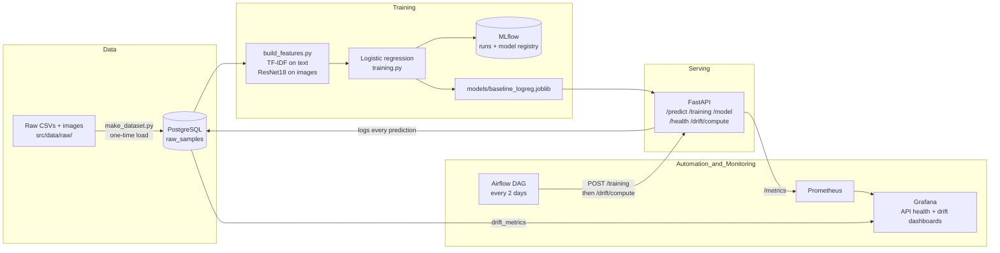

# Rakuten Product Classification: an MLOps Pipeline

Team project of the DataScientest / Liora **MLOps Bootcamp, cohort JUL26 (international)**.
The goal is not the best possible model but a reproducible, monitored, automatically retrained
machine-learning service around it.

**Task:** predict a product's category (`prdtypecode`, 27 classes) from its French title
(`designation`), its description and its photo, using the
[Rakuten France Multimodal Product Data Classification](https://challengedata.ens.fr/challenges/35)
dataset (84,916 labelled products).

## Contents

1. [Team](#1-team)
2. [Architecture](#2-architecture)
3. [Repository layout](#3-repository-layout)
4. [Requirements](#4-requirements)
5. [Setup, step by step](#5-setup-step-by-step)
6. [Using the API](#6-using-the-api)
7. [Experiment tracking and model registry (MLflow)](#7-experiment-tracking-and-model-registry-mlflow)
8. [Scheduled retraining (Airflow)](#8-scheduled-retraining-airflow)
9. [Monitoring (Prometheus, Grafana, Evidently)](#9-monitoring-prometheus-grafana-evidently)
10. [Model and results](#10-model-and-results)
11. [Tests and CI](#11-tests-and-ci)
12. [Troubleshooting](#12-troubleshooting)
13. [Known limitations and roadmap](#13-known-limitations-and-roadmap)

## 1. Team

| Member | GitHub | Main contributions |
|---|---|---|
| TO FILL | [@romealnnr](https://github.com/romealnnr) | TO FILL |
| TO FILL | [@CodingBricks](https://github.com/CodingBricks) | TO FILL |
| TO FILL | [@Sandyyy123](https://github.com/Sandyyy123) | TO FILL |
| TO FILL | [@SrToshi](https://github.com/SrToshi) | TO FILL |

Mentor: Nicolas Fradin ([@NicolasFradin](https://github.com/NicolasFradin)).

## 2. Architecture



All services run as Docker containers defined in `docker-compose.yml`:

| Service | Container | Address on your machine | Purpose |
|---|---|---|---|
| `db` | `mlops_db` | `localhost:${POSTGRES_PORT}` | PostgreSQL: data, predictions, drift results, MLflow tracking |
| `api` | `mlops_api` | <http://localhost:8000/docs> | FastAPI: training, prediction, drift |
| `airflow-apiserver` | `airflow_apiserver` | <http://localhost:8081> | Airflow web UI |
| `airflow-scheduler`, `airflow-dag-processor`, `airflow-init` | | | Airflow internals |
| `prometheus` | `prometheus` | <http://localhost:9090> | Collects API metrics |
| `grafana` | `grafana` | <http://localhost:3000> | Dashboards |
| `ingest` (profile `tools`) | | | Optional one-shot data load |

## 3. Repository layout

```
.
├── dags/rakuten_continuous_training.py   Airflow DAG: retrain + drift every 2 days
├── monitoring/
│   ├── prometheus/prometheus.yml         Scrapes the API's /metrics
│   └── grafana/                          Data sources and 2 dashboards (API health, data drift)
├── src/
│   ├── config.py                         Paths and settings read from .env
│   ├── api/main.py                       FastAPI app and endpoints
│   ├── data/make_dataset.py              Loads the CSVs and image paths into PostgreSQL
│   ├── data/db.py                        Database tables (SQLAlchemy)
│   ├── data/test_db.py                   Database tests
│   ├── features/build_features.py        Feature pipeline (TF-IDF + image embeddings)
│   ├── features/image_features.py        ResNet18 image embeddings (512 values per image)
│   ├── models/training.py                Training, MLflow logging, champion/challenger comparison
│   ├── models/predict.py                 Prediction and prediction logging
│   └── monitoring/drift.py               Evidently data-drift computation
├── Dockerfile                            API image
├── docker-compose.yml                    All services
├── .env_example                          Settings template (copy to .env)
├── requirements.txt / pyproject.toml     Python dependencies
└── src/data/raw/                         Raw data (NOT in Git, you add it, see 5.2)
```

## 4. Requirements

- Docker with Docker Compose v2.
- The Rakuten data: `X_train_update.csv`, `Y_train_CVw08PX.csv` and the `image_train` folder.
- Disk: the API image contains the training images, so it is several GB.
- Time on a laptop CPU: first build about 30 minutes; full training several hours
  (most of it is computing image embeddings).

## 5. Setup, step by step

### 5.1 Get the code

```bash
git clone https://github.com/romealnnr/jul26_bmlops_int_rakuten.git
cd jul26_bmlops_int_rakuten
```

### 5.2 Add the data

The code expects exactly this layout (`src/config.py`):

```
src/data/raw/
├── X_train_update.csv
├── Y_train_CVw08PX.csv
└── image_train/
    └── image_train/
        └── image_<imageid>_product_<productid>.jpg
```

`src/data/raw/` is listed in `.gitignore`, so the data is never committed.

### 5.3 Create your settings file

```bash
cp .env_example .env
```

Then edit `.env`:

- set your own `POSTGRES_PASSWORD` (letters and digits; PostgreSQL reads the login only the first time
  the database volume is created);
- keep `POSTGRES_HOST=db` (the database's service name inside Docker);
- if port 5432 is already used on your machine, set `POSTGRES_PORT` to a free port such as `5433`
  (only the host side changes; the containers still talk to each other on 5432).

`src/config.py` requires all of these keys: `POSTGRES_USER`, `POSTGRES_PASSWORD`, `POSTGRES_DB`,
`POSTGRES_HOST`, `POSTGRES_PORT`, `MODEL_NAME`, `TARGET_COLUMN`, `TEST_SIZE`, `RANDOM_STATE`,
`API_HOST`, `API_PORT`, `LOG_LEVEL`, `MLFLOW_EXPERIMENT_NAME`, `MLFLOW_REGISTERED_MODEL_NAME`.
The full stack also uses `AIRFLOW_UID`, `AIRFLOW_JWT_SECRET`, `AIRFLOW_FERNET_KEY` and,
optionally, `GRAFANA_ADMIN_PASSWORD`.

### 5.4 Start the services

The API container runs as user ID 1000. If you work as root, give it the output folders first:

```bash
mkdir -p models reports mlruns
chown 1000:1000 models reports mlruns
```

Start only the database and the API (enough for training and prediction):

```bash
docker compose up -d --build db api
```

or the full stack (adds Airflow, Prometheus and Grafana on ports 8081, 9090 and 3000):

```bash
docker compose up -d --build
```

Check:

```bash
docker compose ps
curl http://localhost:8000/health
# {"status":"ok","database":"up","model_available":false}
```

### 5.5 Load the data into PostgreSQL (once)

```bash
docker compose exec api python -m src.data.make_dataset --force
```

Expected: 84,916 rows in `raw_samples`, each with its image path. `--force` empties the table first.

### 5.6 Train

Quick check of the whole pipeline on 3,000 rows (a few minutes):

```bash
docker compose exec api python -m src.models.training --limit 3000
```

Full training (several hours; keep the machine awake):

```bash
docker compose exec api python -m src.models.training
```

The last log line shows the scores and the registry decision, for example
`accuracy=... | weighted_f1=... | décision=promoted`. Metrics are saved to
`reports/baseline_logreg_metrics.json` and the model to `models/baseline_logreg.joblib`.

### 5.7 Daily use

```bash
docker compose up -d            # start
docker compose down             # stop (keeps the data)
docker compose up -d --build    # after any code change: rebuild AND recreate the containers
```

`docker compose down -v` also deletes the database volume (all loaded data and MLflow tracking).

## 6. Using the API

Interactive documentation: <http://localhost:8000/docs>.

| Method | Route | What it does |
|---|---|---|
| GET | `/health` | API, database and model status |
| GET | `/model` | Metadata and metrics of the model being served |
| POST | `/training` | Trains a model. Optional body: `test_size`, `random_state`, `limit`, `continuous` |
| POST | `/predict` | Predicts `prdtypecode` for one or more products |
| POST | `/drift/compute` | Computes data drift with Evidently and stores it |
| GET | `/metrics` | Prometheus metrics (not shown in `/docs`) |

Prediction example:

```bash
curl -X POST http://localhost:8000/predict \
  -H "Content-Type: application/json" \
  -d '{"records": [{"designation": "Console de jeu portable retro",
                    "description": "400 jeux inclus",
                    "image_path": null}]}'
```

`image_path: null` is accepted: the image part then contributes a zero vector and the prediction
relies on the text.

Command-line equivalents:

```bash
docker compose exec api python -m src.models.predict --sample                 # predict a sample from the database
docker compose exec api python -m src.models.predict --input payload.json     # predict from a JSON file
```

## 7. Experiment tracking and model registry (MLflow)

- Every training run is logged to MLflow: parameters, metrics (accuracy, weighted F1),
  the classification report, the confusion matrix and a fingerprint of the data.
- The tracking backend is the project's PostgreSQL database; artifacts are written to `./mlruns`.
- Each trained model is registered under `MLFLOW_REGISTERED_MODEL_NAME`. The new model is compared
  with the current "Production" version on weighted F1 and promoted if it is better.
- There is no MLflow web UI service yet (see roadmap).

## 8. Scheduled retraining (Airflow)

`dags/rakuten_continuous_training.py` defines the DAG `rakuten_continuous_training`:

1. every 2 days, call `POST /training` with `{"continuous": true}`, which trains on the next
   slice of 3,000 rows (tracked in the `pipeline_cursor` table);
2. then call `POST /drift/compute`.

Airflow UI: <http://localhost:8081> (full stack only).

## 9. Monitoring (Prometheus, Grafana, Evidently)

- **Prometheus** (<http://localhost:9090>) scrapes the API's `/metrics` every 15 seconds.
- **Grafana** (<http://localhost:3000>, user `admin`, password from `GRAFANA_ADMIN_PASSWORD`)
  is provisioned with two dashboards:
  - *API Health*: requests per second, latency p50/p95/p99, error rate (non-2xx),
    API availability, request volume per endpoint;
  - *Data Drift*: drift score per column over time, latest drift metrics.
- **Evidently** (`src/monitoring/drift.py`) compares a fixed reference (the first 3,000 rows)
  with the latest 3,000-row window and stores the result in the `drift_metrics` table,
  which the *Data Drift* dashboard reads.

## 10. Model and results

| Part | Method |
|---|---|
| Title | TF-IDF, 5,000 most frequent terms |
| Description | TF-IDF, 5,000 most frequent terms |
| Image | Frozen ResNet18 (ImageNet weights), 512-value embedding |
| Classifier | Logistic regression |
| Split | Stratified, `TEST_SIZE` and `RANDOM_STATE` from `.env` (0.2 and 42 by default: 67,932 train / 16,984 test rows) |
| Main metric | Weighted F1 (the 27 classes are unbalanced) |

| Run | Rows | Weighted F1 | Accuracy | Source |
|---|---|---|---|---|
| Pipeline check (`--limit 3000`) | 3,000 | 0.428 | 0.433 | `reports/baseline_logreg_metrics.json`, 10 Oct 2026 |
| Full baseline | 84,916 | TO FILL | TO FILL | `reports/baseline_logreg_metrics.json`, MLflow run ID TO FILL |

The 3,000-row run only checks that the pipeline works end to end; its score is not meaningful.

## 11. Tests and CI

- Tests live next to the code (`src/**/test_*.py`); `pyproject.toml` configures pytest and ruff.
- The tests connect to the PostgreSQL database, so start it first (5.4) and keep your `.env`.
- Run them in a local environment: `pip install -e ".[dev]"`, then `pytest` and `ruff check src`.
- GitHub Actions: `.github/workflows/python-app.yml` (lint, data load, training, tests)
  runs on every pull request and on pushes to `main`.

## 12. Troubleshooting

| Symptom | Cause and fix |
|---|---|
| `port is already allocated` or `address already in use` on 5432 | Another PostgreSQL uses the port. Set `POSTGRES_PORT=5433` in `.env`. |
| The same error on 8081, 9090 or 3000 | Another program uses the port. Start only `db api` (5.4), or free the port. |
| `password authentication failed` | The database volume was created with other credentials. Run `docker compose down`, `docker volume rm jul26_bmlops_int_rakuten_pgdata`, `docker compose up -d`, then reload the data (5.5). |
| `PermissionError` when saving the model or metrics | `models/`, `reports/` or `mlruns/` is owned by root. Run the `chown 1000:1000` line in 5.4. |
| `error getting credentials` when pulling images (WSL) | Pull once with an empty Docker config: `DOCKER_CONFIG=$(mktemp -d) docker pull python:3.12-slim` (same for `postgres:16-alpine`). |
| `ValueError: The least populated classes in y have only 1 member` | `--limit` is too small for a stratified split. Use 3,000 or more. |
| A code change has no effect | Use `docker compose up -d --build`; `docker compose build` alone does not replace the running container. |
| `http://localhost:8000` shows `{"detail":"Not Found"}` | There is no home page. Use `/docs` or `/health`. |
| The API container is missing from `docker compose ps` | It crashed at start-up: `docker compose ps -a` and `docker compose logs api --tail=100`. |

## 13. Known limitations and roadmap

- The API serves the local `models/baseline_logreg.joblib`, which training overwrites after every
  run, even when the registry comparison rejects the new model. Planned: serve the registered
  `@champion` model through MLflow aliases (the stage API used today is deprecated in MLflow 3).
- `productid` and `imageid` are used as model features although they are catalogue identifiers;
  on their own they predict the category with a weighted F1 of 0.695 (random forest), a leakage
  risk. Planned: remove them.
- The training images are copied into the API image, which makes every build slow.
  Planned: exclude `src/data/raw` from the image and mount it as a volume.
- Git is not installed in the API image, so MLflow cannot record which commit produced each model.
- Drift results are stored in PostgreSQL but not yet logged to MLflow.
- The API has no authentication.
- CI triggers on the branch `main`, while this repository's default branch is `master`.
- Planned: MLflow UI service, data versioning with DVC, alerting, a Streamlit demo app.

## Licence

MIT, see [LICENSE](LICENSE) (from the DataScientest project template).
